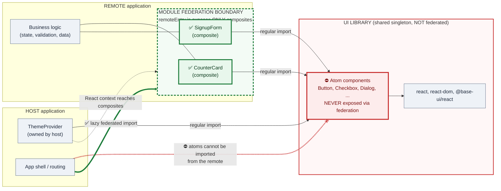
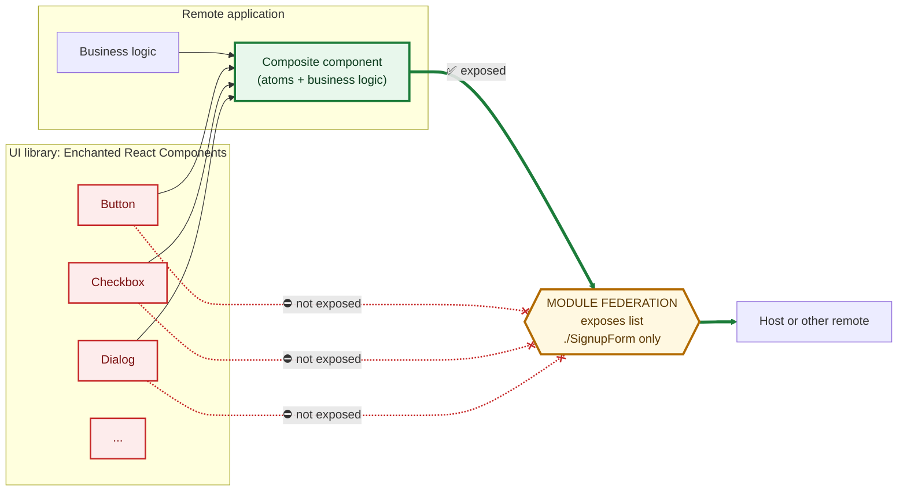
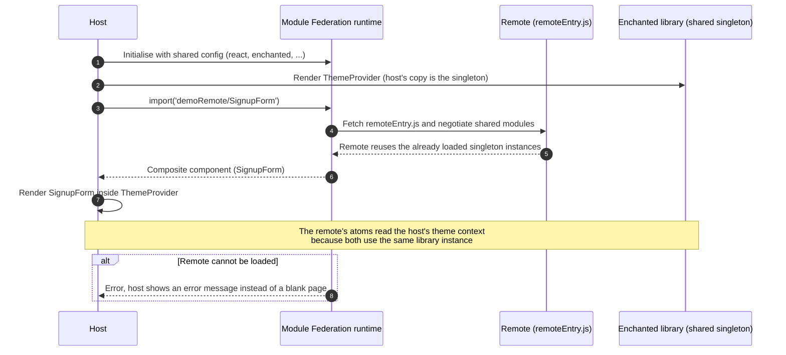
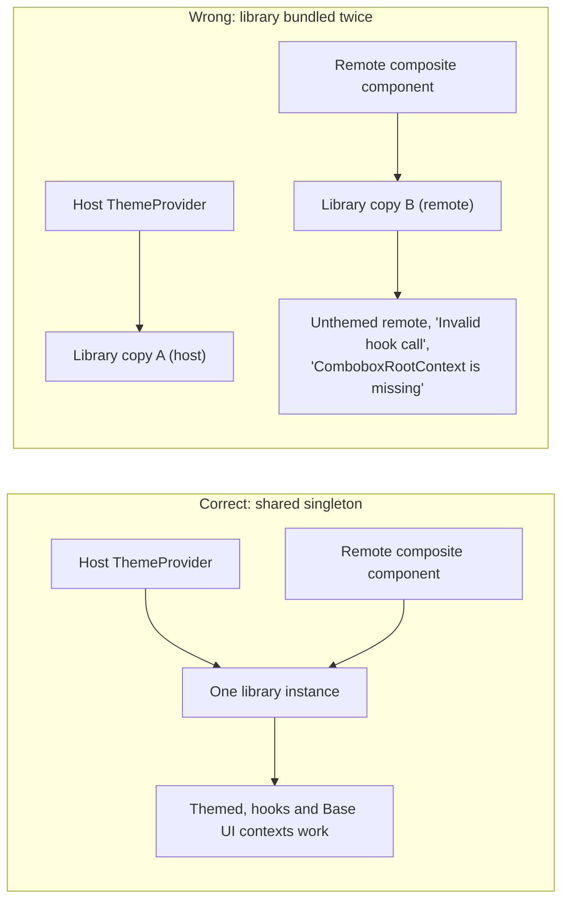

# Module federation guide

This guide describes how the Enchanted React Components library (the UI library) is meant to be used together with
[Module Federation](https://module-federation.io/), and where each piece sits.

## Rules

1. **Atom components are never exposed via Module Federation.** Components such as `Button` or `Checkbox` are not entries in
   any remote's `exposes` list.
2. **The library is only used in a Module Federation context.** Atoms are consumed inside *composite components*, which aggregate
   atoms with business logic. Only those composite components are exposed by a remote.
3. **The library is a shared singleton.** Host and remote resolve the same single copy of `@hcl-software/enchanted-react-components`
   (plus `react`, `react-dom` and `@base-ui/react`) at runtime. This is what lets the host's `ThemeProvider` theme components rendered by a remote.

## Where things are located

The UI library is not a federated module. It is a regular package dependency of the host and of every remote, and Module
Federation only de-duplicates it at runtime through the `shared` configuration.



Green = crosses the federation boundary. Red = stays behind it: atoms are consumed only through regular imports and are de-duplicated at runtime through the `shared` configuration.

| Layer | What it is | Federated? |
| --- | --- | --- |
| Host | Owns `ThemeProvider`, loads remote components lazily | Consumes remotes |
| Remote | Exposes composite components (`./CounterCard`, `./SignupForm`) | Yes, via `exposes` |
| Composite components | Atoms plus business logic | Yes (this is the unit that is exposed) |
| Atom components (UI library) | `Button`, `Checkbox`, ... | **No**, shared singleton only |

## Exposed versus not exposed



## Runtime sequence



## Why the singleton matters



## Demo projects

The `enchanted-demo` repository contains two testing projects. Both load the library across a host/remote boundary with
identical application code, so the bundlers can be compared directly.

| Project | Bundler | Plugin | Details |
| --- | --- | --- | --- |
| `enchanted-demo/packages/module-federation` | Vite | `@module-federation/vite` | `packages/module-federation/README.md` |
| `enchanted-demo/packages/module-federation-rsbuild` | Rsbuild | `@module-federation/rsbuild-plugin` | `packages/module-federation-rsbuild/README.md` |

Both run a host on port 4173 and a remote on port 4174 (do not run both projects at the same time). The remote exposes
`./CounterCard` and `./SignupForm`. `packages/MF-COMPARISON.md` in the same repository compares the two bundlers.

### What the demos verify

- A host-owned `ThemeProvider` (light/dark toggle) themes remote components, because the library is a shared singleton.
- A remote `Dialog` (portal/overlay) opens and works inside the host.
- Props and callbacks cross the boundary (`onCountChange`, `onSubmit`).
- A failed remote load shows an error message rather than a blank page.
- Rsbuild only: the `SelectSingle` option list (shared `@base-ui/react/` subpath) opens and applies a selection.

### Shared configuration (single source for host and remote)

```ts
export const shared = {
  react: { singleton: true, requiredVersion: '^19.0.0' },
  'react-dom': { singleton: true, requiredVersion: '^19.0.0' },
  '@base-ui/react': { singleton: true },
  // Trailing slash shares every subpath, e.g. '@base-ui/react/combobox'
  '@base-ui/react/': { singleton: true },
  '@hcl-software/enchanted-react-components': { singleton: true },
};
```

Keep this list identical on host and remote. A mismatch shows up as "Invalid hook call" or an unthemed remote component.

## Pitfalls

| Symptom | Likely cause | Verification / fix |
| --- | --- | --- |
| "Invalid hook call" or unthemed remote component | `shared` differs between host and remote, or the library is bundled twice | Compare both `shared` configs; use one shared `shared.ts` |
| "`<Part>RootContext` is missing" (e.g. Combobox) | `@base-ui/react/` subpath not shared | Add the trailing-slash entry `'@base-ui/react/'` |
| Vite dev: "does not provide an export named `useSyncExternalStore`" | CommonJS subpaths of `use-sync-external-store` not prebundled | Add them to `optimizeDeps.include` |
| Vite dev: host breaks when remote runs | Both dev servers share `node_modules/.vite` | Use a separate `cacheDir` per app |
| Rsbuild: `RUNTIME-006` (`loadShareSync`) | No async boundary at app entry | Boot via `src/index.ts` that dynamically imports `main.tsx` |
| Rsbuild: remote chunks fail to load from host | Missing `assetPrefix` or CORS for the host origin | Set `output.assetPrefix` / `dev.assetPrefix` on the remote and allow the host origin in `server.cors` |

Further notes: type generation is disabled (`dts: false`), remote types are hand-written in `host/src/remote.d.ts`, and the
remote URL is set via `REMOTE_URL` (build time). There are no automated tests yet; the demos were verified manually in Chrome
only. A deployed remote URL and other browsers are not verified.
